<div align="center">


# ✨ VtubRust

**A lightweight Live2D avatar app with face tracking for streaming. Written in Rust, uses a fraction of the resources.**

<p>
  
  
  
  
</p>


<br/><br/>

[🚀 Download / demo video](https://github.com/tesutavt/VtubRust/releases/latest) · [🐛 Report a bug](https://github.com/tesutavt/VtubRust/issues) · [💡 Suggest an idea](https://github.com/tesutavt/VtubRust/issues)

</div>


<details>
<summary><b>📑 Contents</b></summary>

- [About](#-about)
- [Screenshots](#-screenshots)
- [Features](#-features)
- [Plugin API (VTube Studio compatible)](#-plugin-api-vtube-studio-compatible)
- [Twitch integration](#-twitch-integration)
- [Tech stack](#%EF%B8%8F-tech-stack)
- [Install and run](#-install-and-run)
- [Project structure](#-project-structure)
- [Roadmap](#%EF%B8%8F-roadmap)
- [Author](#-author)

</details>

## 📖 About

Fan "ports" of programs and games are popular right now, mostly to see what happens to performance.
**VtubRust** (internally `rigrs`) is an educational, independent implementation of what a VTuber app does
when it shows a regular Live2D avatar: rendering the Cubism model, face and hand tracking from a webcam,
items, backgrounds, effects, hotkeys, Twitch, a plugin API and output to OBS. The interface follows the familiar
VTube Studio layout so switching is easy, and models with their settings (`.vtube.json`, including hotkeys)
are picked up as they are.

**Resource usage** (GTX 1660, 56-mesh model, camera off): **60 FPS, ~1 ms CPU per frame,
~1% CPU, ~150–170 MB RAM**. A 480-mesh model with 56 physics chains takes ~2 ms per frame.
The tracker runs as a separate process (OpenSeeFace / Mediapipe); its load is shown in the overlay.

> ⚠️ This project is not affiliated with VTube Studio / DenchiSoft and does not use their code. Only the
> open Live2D model formats and the publicly documented VTube Studio plugin API are used.
> Live2D Cubism Core is the property of Live2D Inc.

## 📸 Screenshots

<p align="center">
  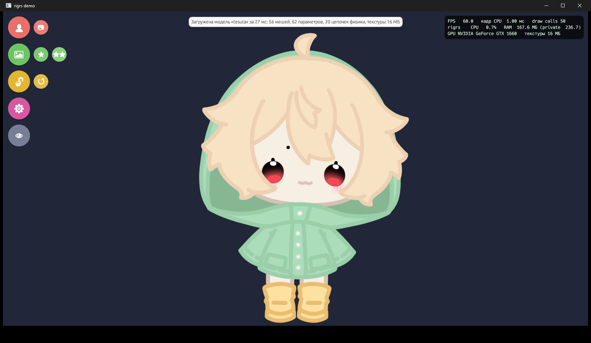
  &nbsp;
  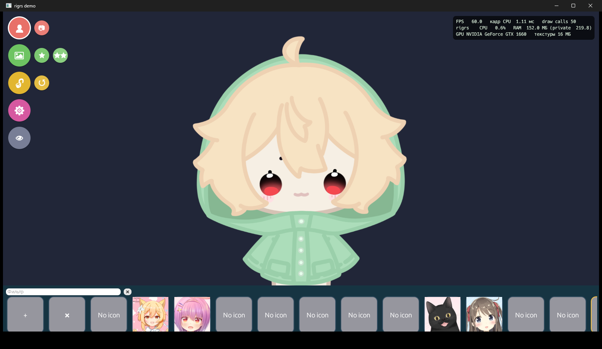
</p>
<p align="center">
  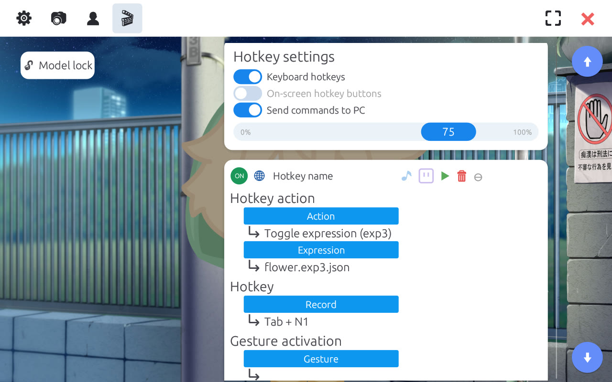
  &nbsp;
  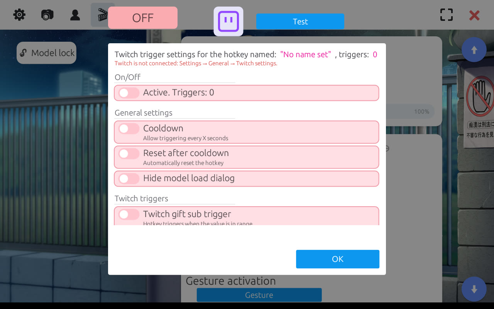
</p>
<p align="center">
  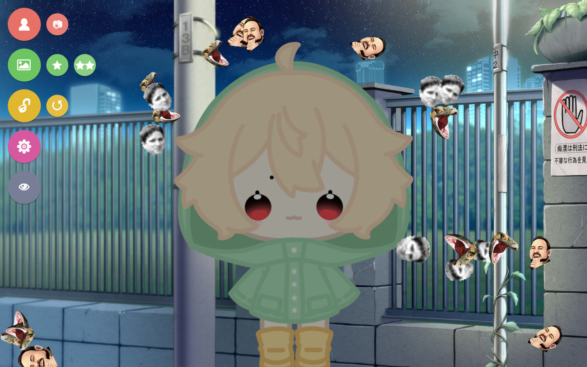
  &nbsp;
  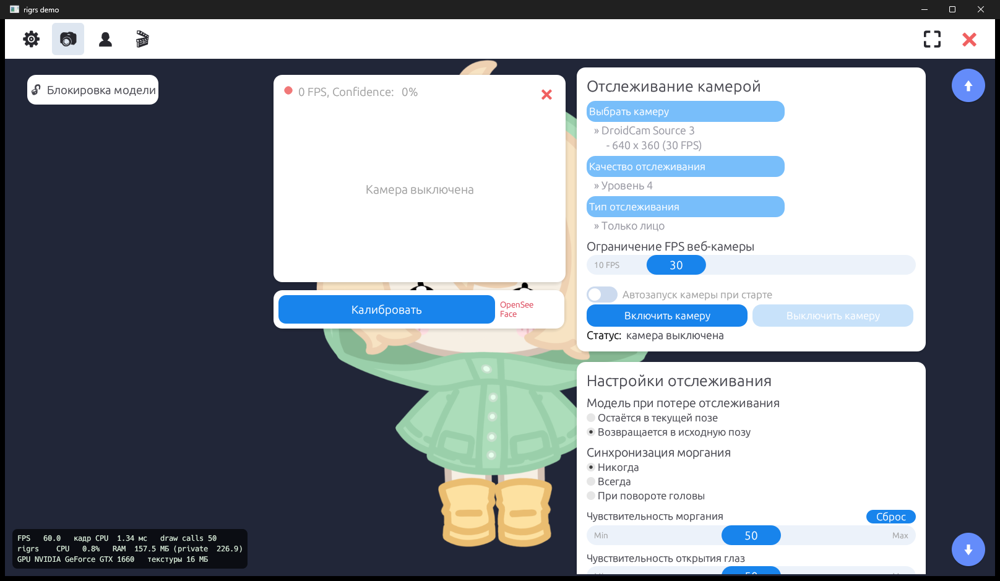
</p>
<p align="center">
  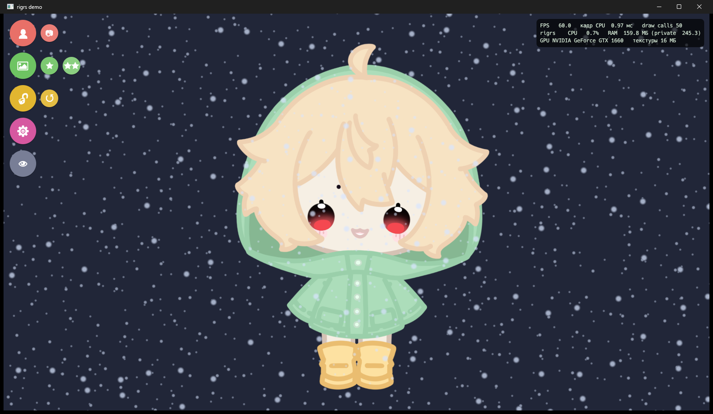
  &nbsp;
  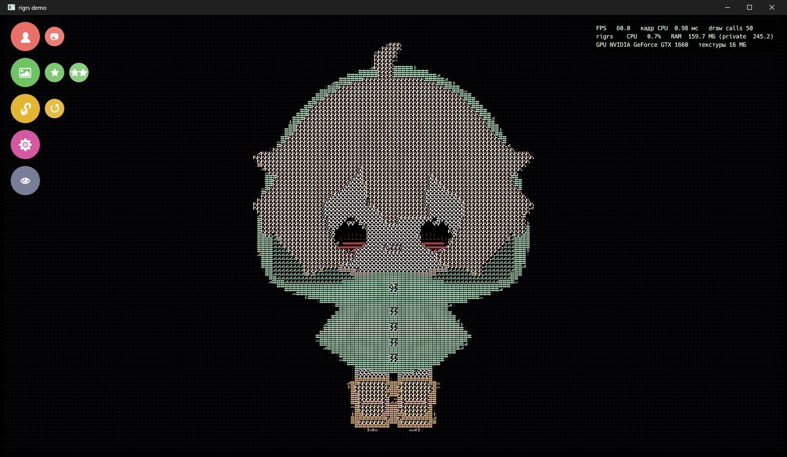
  &nbsp;
  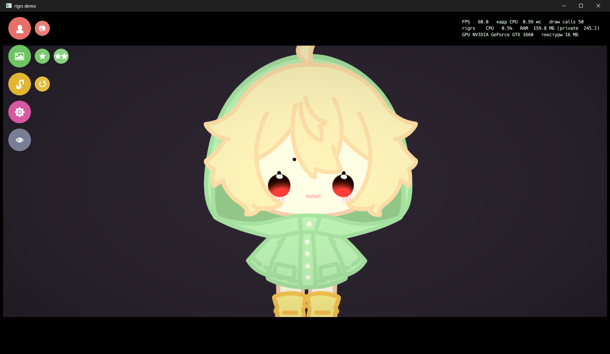
</p>

🎬 A demo video (about 50 seconds) is attached to the [latest release](https://github.com/tesutavt/VtubRust/releases/latest).

## 🆕 dev: NVIDIA / phone tracking, VBridger, VNet-style collab

**Trackers** (Settings → Camera → Tracking quality):
- **[RTX] NVIDIA Broadcast**: runs `ExpressionApp.exe` from VTube Studio's free *NVIDIA Broadcast Tracker* DLC (Windows, RTX 20xx+), the same way VTS does (UDP 9140, JSON with 53 ARKit-style expressions + head rotation). "Calibrate" also sends the NVIDIA neutral-face calibration; the coefficients are saved.
- **[Phone] iPhone / Android**: the VTube Studio phone app's "3rd Party PC Clients" protocol (`iOSTrackingDataRequest` on UDP 21412), 52 ARKit blendshapes + tongue. The phone can feed VBridger at the same time; on-screen buttons 1-8 trigger hotkeys bound to ScreenButton 1-8.

**VBridger / Perfect Sync**: with NVIDIA, phone or Mediapipe tracking every raw ARKit blendshape (`EyeBlinkLeft`, `JawOpen`, `MouthFunnel`, ...) and the VBridger-style combinations (`MouthPressLipOpen`, `MouthPuckerWiden`, `MouthShrug`, `CheekSquint`, `EyeSquint`, `BrowOuterUp`) are available as inputs, so models rigged for VBridger can map them by name. VBridger itself still works through the plugin API; a parameter it creates with the same name takes priority.

**Collab (VNet-style multiplayer)**: purple buttons in the main menu, above "hide UI" (big = setup, small = session control). Host / join with nickname and password, up to 6 participants, Data FPS 10-60. Models and items are shared automatically (zipped, sent through the host, verified by hash, kept in a temporary cache; 150 files / 300 MB per model, 95 MB per file). Movement = Live2D parameters + model/item placement; receivers run physics and smooth with a per-participant buffer. Per participant: show model, show items, in front of my model, "you control position", fixed ordering. No Steam relay: the host must be reachable over TCP (LAN, port forwarding or Tailscale / ZeroTier / Radmin VPN), default port 25580.

<p align="center">
  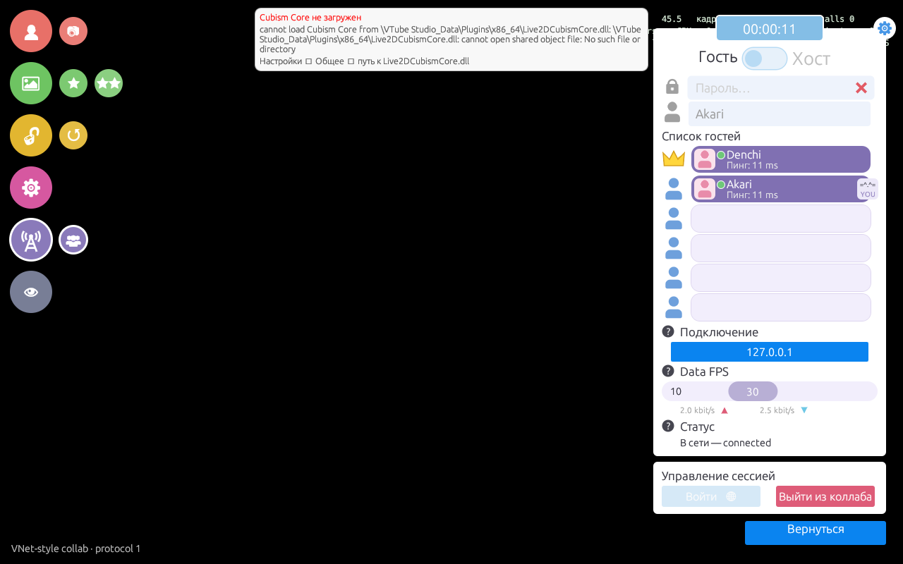 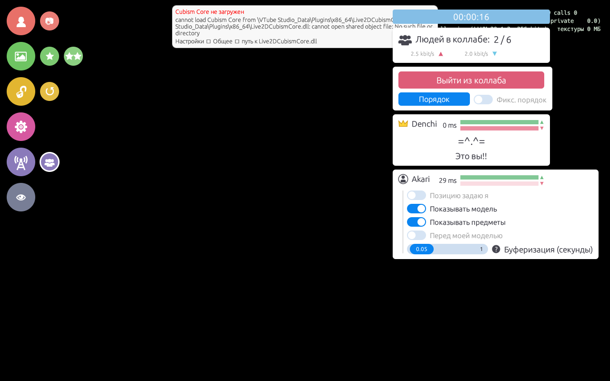
  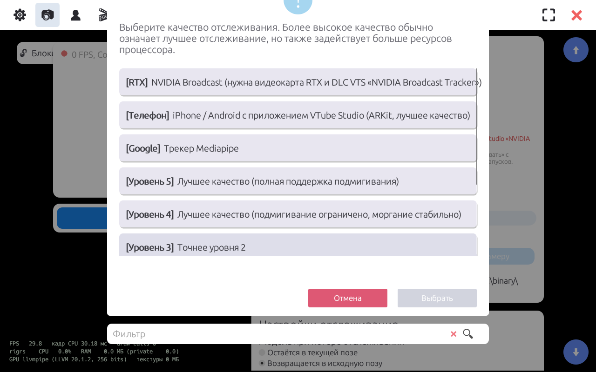 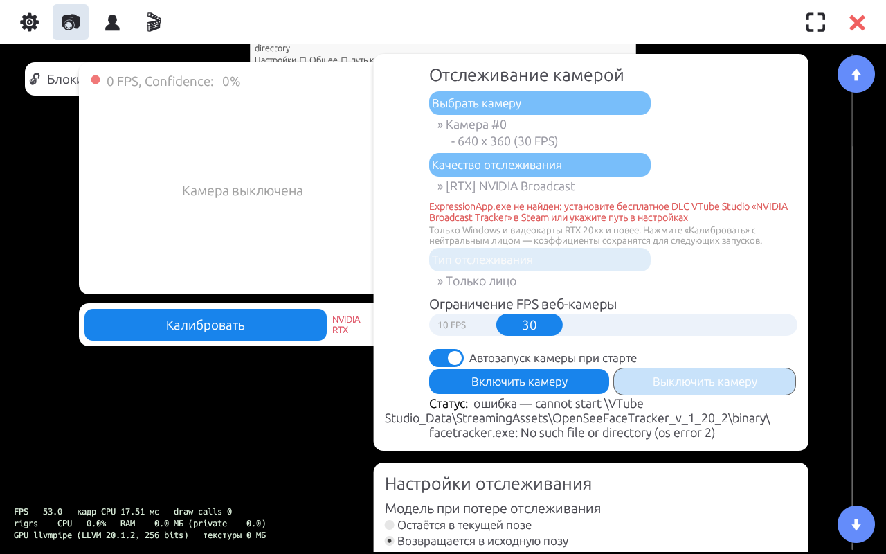
  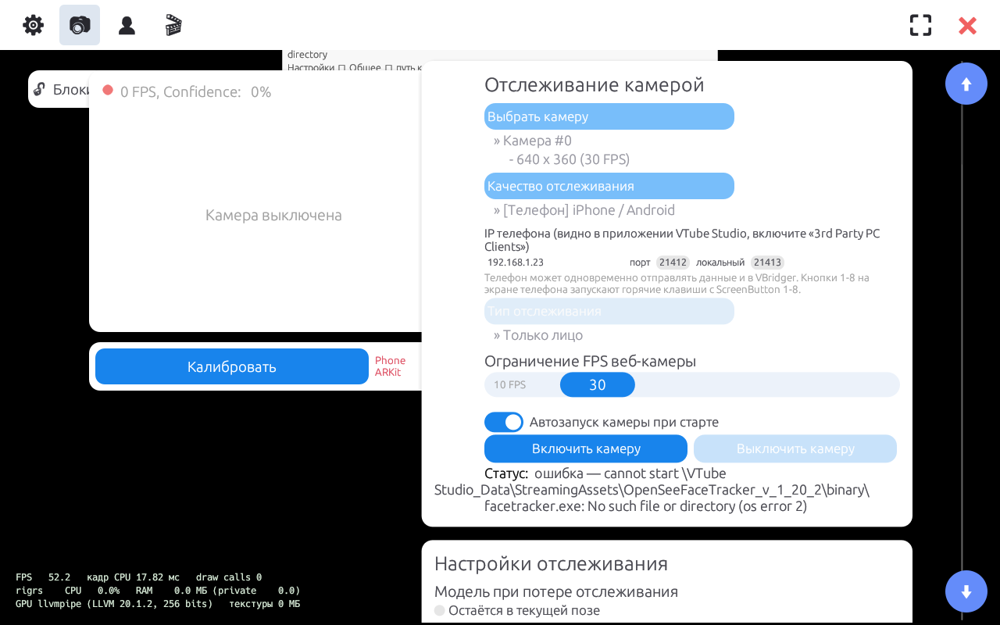 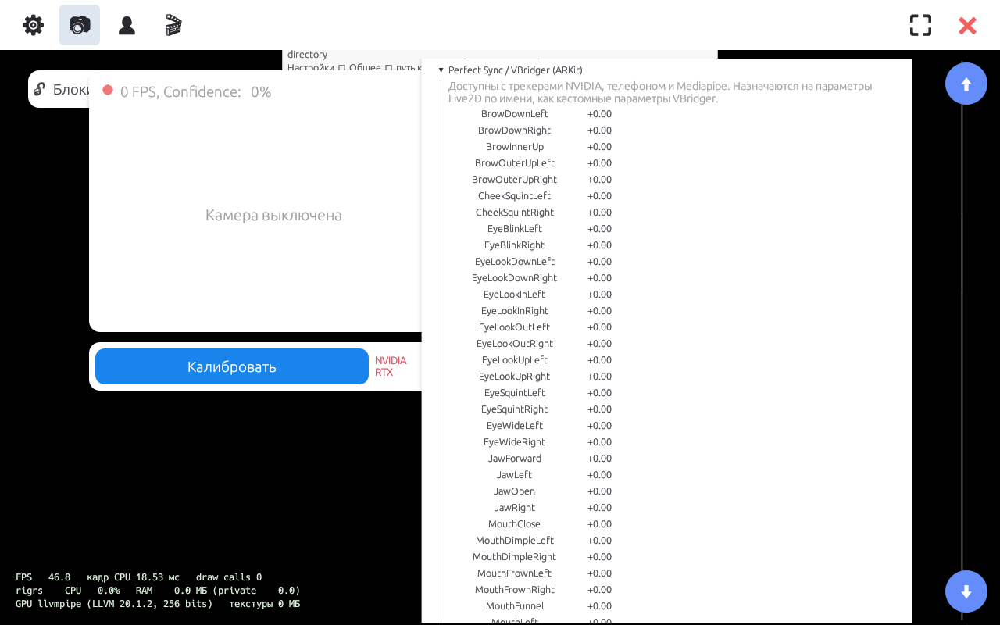
</p>

## 🌟 Features

- ✅ Live2D Cubism 3/4/5 rendering: physics, idle animations, expressions (`exp3`), poses, smooth or hard masks
- ✅ VTube Studio model compatibility: parameter mapping from `.vtube.json`, an "input → output" editor
- ✅ Face tracking: OpenSeeFace (levels 0–5) and **Mediapipe** (blendshapes), **hand** tracking (26 inputs)
- ✅ Calibration, blink/eye/mouth/smile/brow sensitivity, blink sync
- ✅ Mouse input, **Tobii** support (via Tobii Stream Engine)
- ✅ **Hotkeys** in the VTube Studio format, per model, imported from `.vtube.json`:
  2-key combos (keyboard, mouse and controller buttons), global hotkeys, one- and two-hand gestures,
  fade / auto-off / off-on-key-release, on-screen buttons 1–8, up to 10 sound slots per hotkey,
  ArtMesh color presets, screen overlay presets, Live2D item actions
- ✅ **Microphone lipsync**: VoiceA/I/U/E/O, VoiceVolume, VoiceFrequency, VoiceSilence with voice calibration
- ✅ **Controller input**: XInput, DualShock 4 / DualSense (touchpad, gyro), all VTS controller parameters, controller hotkeys
- ✅ **Sound effects**: hotkey sounds, parameter sound triggers, spatial audio, model volume, output to speakers and OBS (VBAN)
- ✅ **Twitch**: chat, hotkey triggers, Emote Dropper, flying chat, BTTV / 7TV / FFZ emotes
- ✅ **Plugin API** compatible with the VTube Studio Public API 1.0
- ✅ Items (PNG/GIF/PNG-folder animations/Live2D): drop an item onto the model and it sticks to that spot,
  item order, items between model layers, Live2D item split, smoothing, censor, drag & drop of files,
  item scenes with groups and fades; Live2D items follow head tracking
- ✅ Per-ArtMesh model settings (VTS `ArtMeshDetails`): pin exclusion, "eat" items, lighting, recoloring, groups
- ✅ Live2D Cubism Editor connection (parameter sync, exported model import)
- ✅ Backgrounds, lighting overlay (a monitor's or window's color tints the model)
- ✅ The **29 VTube Studio visual effects** with their 257 config IDs (bloom, backlight, particles,
  background shift, VHS, datamosh, lens/wave distortion, model glitch …) + presets with fades
- ✅ Output: **Spout2** (with transparency), **NDI**, **Windows 11 virtual camera** (rigrsCam)
- ✅ Live2D animation recording to `.motion3.json`, screenshots
- ✅ Performance overlay: FPS, CPU and RAM of the app and the tracker
- ✅ Interface in **English** and **Russian** (Settings → General → Language)

## 🔌 Plugin API (VTube Studio compatible)

Settings → General → **Plugin API** → "Start API (plugins)". The server speaks the
[VTube Studio Public API](https://github.com/DenchiSoft/VTubeStudio) protocol:

- WebSocket on `ws://localhost:8001` (port configurable, optional LAN access);
- UDP discovery broadcast `VTubeStudioAPIStateBroadcast` on port `47779`;
- token authentication with an Allow / Deny prompt, tokens are remembered, revocable in the settings;
- the same request names, fields and error IDs: model and hotkey requests, expressions, ArtMesh list / tint /
  hit test, input and Live2D parameters, custom parameters and `InjectParameterData`, physics overrides,
  NDI config, items (list / load / unload / move / pin / sort), post-processing, permissions;
- events: `TestEvent`, `ModelLoadedEvent`, `TrackingStatusChangedEvent`, `ModelMovedEvent`,
  `HotkeyTriggeredEvent`, `ExpressionToggledEvent`, `ItemEvent`, `ModelClickedEvent`, `PostProcessingEvent` and others.

Existing VTS plugins and tools connect to rigrs the same way they connect to VTube Studio.

## 💜 Twitch integration

Settings → General → **Twitch settings**.

| What | Without login (channel name only) | With login |
|---|---|---|
| Chat, text commands | ✅ | ✅ |
| Bits, subs, gift subs, raids, Power-Ups | ✅ | ✅ |
| Follows, channel point rewards, shoutouts, ad breaks | — | ✅ (EventSub) |

To log in, create a free app at [dev.twitch.tv/console](https://dev.twitch.tv/console/apps/create)
(client type **Public**), paste its Client ID and press "Log in with Twitch" (device code flow, no password goes through rigrs).

- **Hotkey triggers**: every hotkey has its own Twitch trigger window: text words (with role restrictions),
  bits and gift-sub ranges, rewards, Power-Ups, subs, follows, raids, shoutouts, ad breaks, cooldown and reset.
- **Emote Dropper**: chat emotes fall on the screen and bounce off the model and the window edges.
- **Flying chat**: messages with emotes fly across the screen, with filters (bots, links, words) and limits.

Both effects are drawn on top of the model in the app window **and in the Spout2 / NDI / virtual camera output**, so viewers see them in OBS.

## 🛠️ Tech stack

<p align="left">
  
</p>

Rust · wgpu (DX12/Vulkan) · winit · egui · tungstenite · ureq · Media Foundation (virtual camera) · OpenSeeFace / Mediapipe (tracker)

## 🚀 Install and run

**Prebuilt:** download the archive from the [releases](https://github.com/tesutavt/VtubRust/releases/latest),
unzip it and run `rigrs.exe`.

**What your PC needs:**

| What | Why | Where to get it |
|---|---|---|
| Windows 10/11 x64 | — | the virtual camera needs Windows 11 |
| `Live2DCubismCore.dll` | loading `.moc3` (proprietary Live2D core) | an installed VTube Studio is found automatically; or the official [Cubism SDK for Native](https://www.live2d.com/en/sdk/download/native/): put the DLL next to `rigrs.exe` |
| `facetracker.exe` | webcam tracking | taken from an installed VTube Studio or from [OpenSeeFace](https://github.com/emilianavt/OpenSeeFace/releases) (`OpenSeeFace` folder next to the exe) |
| NDI Tools | NDI output only | [ndi.video](https://ndi.video/tools/) |

Paths can be changed in **Settings → General → Paths**.

**rigrsCam virtual camera:** Settings → Camera → "Installation help" → "Open folder" →
run `install.bat` **as administrator** (once).

**Build from source:**

```bash
# 1. Clone the repository
git clone https://github.com/tesutavt/VtubRust.git
cd VtubRust

# 2. Build (needs Rust: https://rustup.rs and the MSVC Build Tools)
cargo build --release --workspace

# 3. Run
target/release/rigrs.exe
```

## 📂 Project structure

```
VtubRust/
├── src/
│   ├── cubism/        # Cubism Core FFI, physics, motion3, pose3
│   ├── gpu/           # wgpu renderer, shaders, masks, VFX
│   ├── scene/         # model, sprites, items and pinning
│   ├── tracking.rs    # OpenSeeFace / Mediapipe / hands
│   ├── mapping.rs     # "input → parameter" rules (as in .vtube.json)
│   ├── hotkeys.rs     # VTS-format hotkeys, gestures, Twitch trigger matching
│   ├── api.rs         # VTube Studio compatible plugin API (WebSocket + UDP discovery)
│   ├── twitch.rs      # Twitch IRC chat, OAuth device login, EventSub, BTTV/7TV/FFZ
│   ├── twitch_fx.rs   # Emote Dropper and flying chat
│   ├── spout.rs       # video outputs: Spout2, NDI, virtual camera
│   ├── vfx.rs         # visual effects
│   ├── i18n.rs        # English / Russian UI
│   └── ui*.rs         # interface (egui)
├── vcam/              # rigrs_vcam.dll: Windows 11 virtual camera source
├── screenshots/       # images for this README
└── README.md
```

## 🗺️ Roadmap

- [x] Live2D rendering, physics, animations, expressions
- [x] Face and hand tracking, Tobii, mouse
- [x] Items, backgrounds, lighting, VFX
- [x] Spout2, NDI, virtual camera
- [x] Hotkeys (VTube Studio format), gestures, on-screen buttons
- [x] Plugin API (VTube Studio compatible)
- [x] Twitch integration
- [x] English / Russian interface
- [x] Twitch effects in the Spout2 / NDI / virtual camera output
- [x] Microphone lipsync
- [x] Controller input
- [x] Sound effects, VBAN
- [x] VTS effect set, item system, ArtMesh settings, Cubism Editor API
- [ ] Phone tracking (VTube Studio iPhone/Android app protocol)
- [ ] Own multiplayer (collabs between rigrs users)
- [ ] Web items
- [ ] Auto-updater from GitHub releases
- [ ] Discord, mocopi

## 💜 Author

<table>
  <tr>
    <td align="center">
      <a href="https://github.com/tesutavt">
        <br/>
        <b>Tesuta</b>
      </a><br/>
      <sub>VTuber · programmer</sub>
    </td>
  </tr>
</table>


<p align="center">
  <i>If you like the project, leave a ⭐. It means a lot!</i>
</p>
