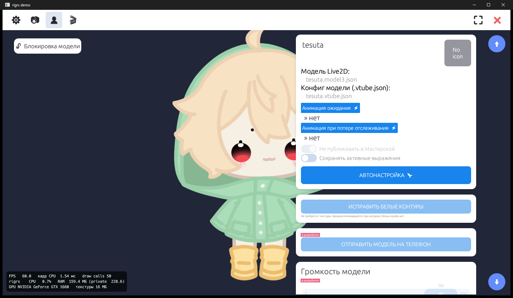

<div align="center">


# ✨ VtubRust

**Лёгкий Live2D-аватар с трекингом лица для стримов — написан на Rust, ест в разы меньше ресурсов.**

<p>
  
  
  
  
</p>


<br/><br/>

[🚀 Скачать / демо-видео](https://github.com/tesutavt/VtubRust/releases/latest) · [🐛 Сообщить об ошибке](https://github.com/tesutavt/VtubRust/issues) · [💡 Предложить идею](https://github.com/tesutavt/VtubRust/issues)

</div>


<details>
<summary><b>📑 Содержание</b></summary>

- [О проекте](#-о-проекте)
- [Скриншоты](#-скриншоты)
- [Возможности](#-возможности)
- [Технологии](#%EF%B8%8F-технологии)
- [Установка и запуск](#-установка-и-запуск)
- [Структура проекта](#-структура-проекта)
- [Планы](#%EF%B8%8F-планы)
- [Автор](#-автор)

</details>

## 📖 О проекте

Сейчас популярно делать фанатские переносы программ и смотреть, что будет с производительностью.
**VtubRust** (внутри — `rigrs`) — учебная независимая реализация того, что делает VTuber-приложение
при показе обычного Live2D-аватара: рендер Cubism-модели, трекинг лица и рук с веб-камеры,
предметы, фоны, эффекты и вывод в OBS. Интерфейс повторяет привычную раскладку VTube Studio,
чтобы было легко переключиться, а модели с их настройками (`.vtube.json`) подхватываются как есть.

**Сколько ест** (GTX 1660, модель на 56 мешей, без камеры): **60 FPS, ~1 мс CPU на кадр,
~1% CPU, ~150–170 МБ RAM**. Модель на 480 мешей и 56 цепочек физики — ~2 мс на кадр.
Трекер работает отдельным процессом (OpenSeeFace / Mediapipe), его нагрузку видно в оверлее.

> ⚠️ Проект не связан с VTube Studio / DenchiSoft и не использует их код. Используются только
> открытые форматы моделей Live2D. Live2D Cubism Core — собственность Live2D Inc.

## 📸 Скриншоты

<p align="center">
  
  &nbsp;
  
</p>
<p align="center">
  
  &nbsp;
  
</p>
<p align="center">
  
  &nbsp;
  
  &nbsp;
  
</p>

🎬 Демо-видео (50 секунд) лежит в [последнем релизе](https://github.com/tesutavt/VtubRust/releases/latest).

## 🌟 Возможности

- ✅ Рендер Live2D Cubism 3/4/5: физика, idle-анимации, выражения (`exp3`), позы, сглаженные или жёсткие маски
- ✅ Совместимость с моделями VTube Studio: маппинг параметров из `.vtube.json`, редактор «вход → выход»
- ✅ Трекинг лица: OpenSeeFace (уровни 0–5) и **Mediapipe** (blendshape-ы), трекинг **рук** (26 входов)
- ✅ Калибровка, чувствительность моргания/глаз/рта/улыбки/бровей, синхронизация моргания
- ✅ Ввод мыши, поддержка **Tobii** (через Tobii Stream Engine)
- ✅ Предметы (PNG/GIF/Live2D) с привязкой к мешу модели, сцены предметов и хоткеи
- ✅ Фоны, наложение освещения (цвет монитора или окна тонирует модель)
- ✅ 18 визуальных эффектов (снег, свечение, подсветка, ASCII, помехи, кино и др.) + пресеты
- ✅ Вывод: **Spout2** (с прозрачностью), **NDI**, **виртуальная камера Windows 11** (rigrsCam)
- ✅ Запись анимации Live2D в `.motion3.json`, скриншоты
- ✅ Оверлей производительности: FPS, CPU, RAM приложения и трекера

## 🛠️ Технологии

<p align="left">
  
</p>

Rust · wgpu (DX12/Vulkan) · winit · egui · Media Foundation (виртуальная камера) · OpenSeeFace / Mediapipe (трекер)

## 🚀 Установка и запуск

**Готовая сборка:** скачайте архив из [релизов](https://github.com/tesutavt/VtubRust/releases/latest),
распакуйте и запустите `rigrs.exe`.

**Что нужно на компьютере:**

| Что | Зачем | Где взять |
|---|---|---|
| Windows 10/11 x64 | — | виртуальная камера — только Windows 11 |
| `Live2DCubismCore.dll` | загрузка `.moc3` (проприетарное ядро Live2D) | установленная VTube Studio подхватится сама; или официальный [Cubism SDK for Native](https://www.live2d.com/en/sdk/download/native/) — положите DLL рядом с `rigrs.exe` |
| `facetracker.exe` | трекинг с веб-камеры | берётся из установленной VTube Studio или из [OpenSeeFace](https://github.com/emilianavt/OpenSeeFace/releases) (папка `OpenSeeFace` рядом с exe) |
| NDI Tools | только для вывода NDI | [ndi.video](https://ndi.video/tools/) |

Пути можно поменять в **Настройки → Общее → Пути**.

**Виртуальная камера rigrsCam:** Настройки → Камера → «Помощь с установкой» → «Открыть папку» →
запустите `install.bat` **от имени администратора** (один раз).

**Сборка из исходников:**

```bash
# 1. Клонировать репозиторий
git clone https://github.com/tesutavt/VtubRust.git
cd VtubRust

# 2. Собрать (нужен Rust: https://rustup.rs и MSVC Build Tools)
cargo build --release --workspace

# 3. Запустить
target/release/rigrs.exe
```

## 📂 Структура проекта

```
VtubRust/
├── src/
│   ├── cubism/      # FFI к Cubism Core, физика, motion3, pose3
│   ├── gpu/         # wgpu-рендер, шейдеры, маски, VFX
│   ├── scene/       # модель, спрайты, предметы и их привязка
│   ├── tracking.rs  # OpenSeeFace / Mediapipe / руки
│   ├── mapping.rs   # правила «вход → параметр» (как в .vtube.json)
│   ├── spout.rs     # видеовыходы: Spout2, NDI, виртуальная камера
│   ├── vfx.rs       # визуальные эффекты
│   └── ui.rs        # интерфейс (egui)
├── vcam/            # rigrs_vcam.dll — источник виртуальной камеры Windows 11
├── screenshots/     # картинки для README
└── README.md
```

## 🗺️ Планы

- [x] Рендер Live2D, физика, анимации, выражения
- [x] Трекинг лица и рук, Tobii, мышь
- [x] Предметы, фоны, освещение, VFX
- [x] Spout2, NDI, виртуальная камера
- [ ] API для плагинов (совместимый с VTube Studio)
- [ ] Липсинк по микрофону
- [ ] Трекинг с телефона (Wi-Fi / USB)
- [ ] Twitch-интеграция, Discord, mocopi
- [ ] Звуковые эффекты, контроллер

## 💜 Автор

<table>
  <tr>
    <td align="center">
      <a href="https://github.com/tesutavt">
        <br/>
        <b>Tesuta</b>
      </a><br/>
      <sub>втубер · программист</sub>
    </td>
  </tr>
</table>


<p align="center">
  <i>Если проект понравился — поставь ⭐, мне будет приятно!</i>
</p>
